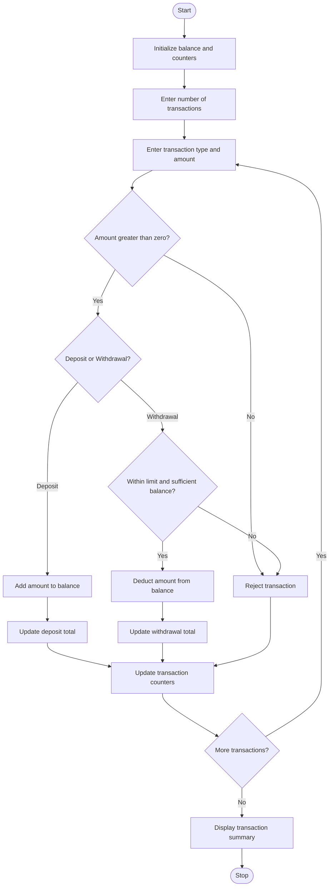

# ATM Transaction Sequence Simulation Using Python

## 1. Problem Statement
ATM Transaction Sequence Simulation: Process a sequence of deposits and withdrawals, maintain a simulated balance, enforce withdrawal limits, reject invalid transactions, and produce a transaction summary

## 2. Algorithm

1. Start the program.
2. Initialize the account balance, total deposits, total withdrawals, and transaction counters.
3. Set the maximum withdrawal limit to ₹10,000 per transaction.
4. Ask the user to enter the number of transactions.
5. Repeat the following steps for each transaction:
   - Accept the transaction type (`D` for deposit or `W` for withdrawal).
   - Accept the transaction amount.
   - If the amount is zero or negative, reject the transaction.
   - If the transaction is a deposit, add the amount to the balance and total deposits.
   - If the transaction is a withdrawal:
     - Check whether the amount exceeds the withdrawal limit.
     - Check whether sufficient balance is available.
     - If both conditions are satisfied, deduct the amount from the balance and update total withdrawals.
     - Otherwise, reject the transaction.
   - Update the successful or rejected transaction count.
6. Display the transaction summary.
7. Stop the program.

## 3. Simple Flowchart 




## 5. Sample Input

text

```
Enter number of transactions: 5

Transaction 1
Enter type (D/W): D
Enter amount: 2000

Transaction 2
Enter type (D/W): W
Enter amount: 1500

Transaction 3
Enter type (D/W): W
Enter amount: 12000

Transaction 4
Enter type (D/W): W
Enter amount: 7000

Transaction 5
Enter type (D/W): D
Enter amount: 1000
```

## 6. Sample Output

text

```
Transaction 1
Deposit successful

Transaction 2
Withdrawal successful

Transaction 3
Rejected: Withdrawal limit exceeded

Transaction 4
Rejected: Insufficient balance

Transaction 5
Deposit successful

----- ATM TRANSACTION SUMMARY -----
Total deposits: Rs. 3000.00
Total withdrawals: Rs. 1500.00
Successful transactions: 3
Rejected transactions: 2
Final balance: Rs. 3500.00
```

