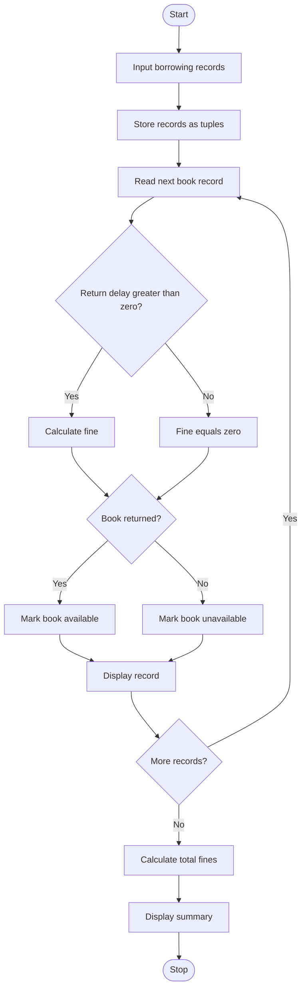

Library Borrowing and Fine Reconciliation Using Python


## 1. Problem Statement
Library Borrowing and Fine Reconciliation: Analyse tuples representing book identifiers, borrowing periods, and return delays; calculate fines, identify overdue records, and reconcile book availability


## 2. Algorithm

1. Start the program.
2. Input the number of borrowing records.
3. For each record, input the book ID, borrowing period, return delay, and return status.
4. Store the information in tuples.
5. Calculate the overdue days using the return delay.
6. Calculate the fine as overdue days multiplied by ₹5.
7. Identify overdue books.
8. Determine availability based on the return status.
9. Display the fine, overdue status, and availability of each book.
10. Calculate and display the total fine.
11. Stop the program.

## 3.  Flowchart





## 5. Sample Input

text

```
Enter number of borrowing records: 3

Record 1
Enter book ID: B101
Enter borrowing period in days: 14
Enter return delay in days: 0
Has the book been returned? (yes/no): yes

Record 2
Enter book ID: B102
Enter borrowing period in days: 14
Enter return delay in days: 3
Has the book been returned? (yes/no): yes

Record 3
Enter book ID: B103
Enter borrowing period in days: 14
Enter return delay in days: 5
Has the book been returned? (yes/no): no
```

## 6. Sample Output

text

```
===== LIBRARY RECONCILIATION REPORT =====

Book ID: B101
Borrowing period: 14 days
Return delay: 0 days
Fine: Rs. 0
Status: On time
Availability: Available

Book ID: B102
Borrowing period: 14 days
Return delay: 3 days
Fine: Rs. 15
Status: Overdue
Availability: Available

Book ID: B103
Borrowing period: 14 days
Return delay: 5 days
Fine: Rs. 25
Status: Overdue
Availability: Not available

===== SUMMARY =====
Total records: 3
Overdue records: 2
Total fines: Rs. 40
```

