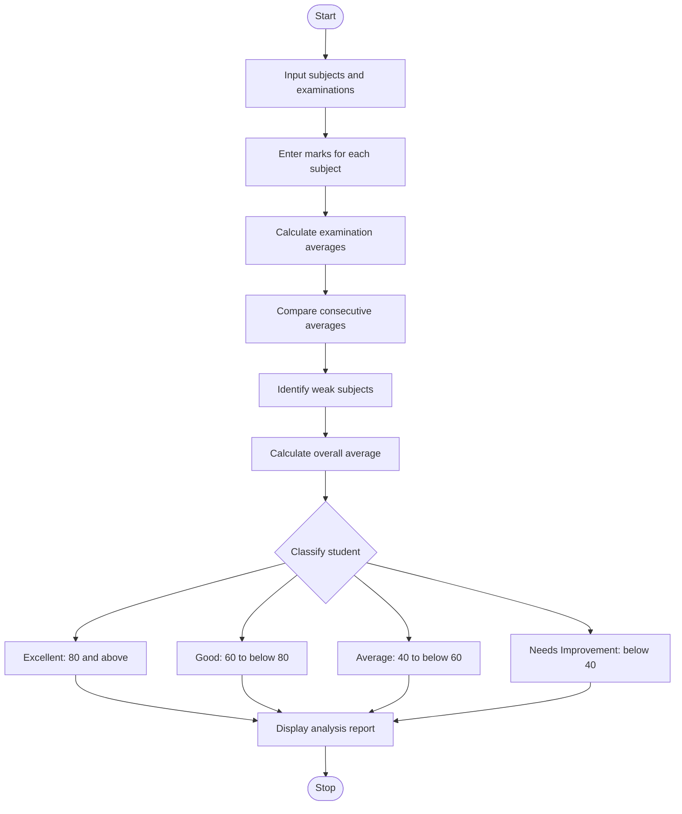

# Student Performance Trend Analysis Using Python

## 1. Problem Statement
Student Performance Trend Analysis: Compare assessment scores across multiple examinations, calculate improvements and declines, identify consistently weak subjects, and classify students according to defined criteria

## 2. Algorithm

1. Start the program.
2. Input the number of subjects and examinations.
3. Enter the subject names and the marks obtained in each examination.
4. Calculate the average marks for each examination.
5. Compare consecutive examination averages to identify improvements or declines.
6. Check each subject to identify consistently weak performance.
7. Calculate the overall average marks.
8. Classify the student:
   - 80 and above: Excellent
   - 60 to below 80: Good
   - 40 to below 60: Average
   - Below 40: Needs Improvement
9. Display examination averages, performance trends, weak subjects, and student classification.
10. Stop the program.

## 3.  Flowchart 



## 5. Sample Input

text

```
Enter subject names separated by spaces: Maths Science English
Enter number of examinations: 3
Enter marks in Maths for Exam 1: 70
Enter marks in Maths for Exam 2: 80
Enter marks in Maths for Exam 3: 90
Enter marks in Science for Exam 1: 35
Enter marks in Science for Exam 2: 38
Enter marks in Science for Exam 3: 36
Enter marks in English for Exam 1: 60
Enter marks in English for Exam 2: 65
Enter marks in English for Exam 3: 70
```

## 6. Sample Output

text

```
EXAMINATION AVERAGES
Exam 1: 55.00
Exam 2: 61.00
Exam 3: 65.33

PERFORMANCE TRENDS
Exam 1 to Exam 2: Improved by 6.00
Exam 2 to Exam 3: Improved by 4.33

CONSISTENTLY WEAK SUBJECTS
Science

Overall Average: 60.44
Student Classification: Good
```

