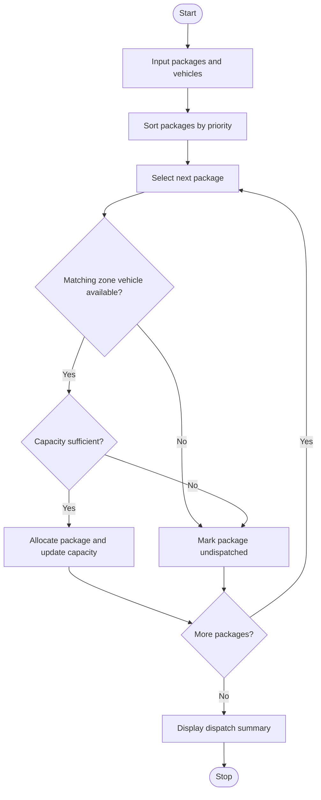

# Multi-Route Courier Dispatch Planning Using Python

## 1. Problem Statement
Multi-Route Courier Dispatch Planning: Process package weights, destination zones, vehicle capacities, and delivery priorities; allocate packages to vehicles and identify packages that cannot be dispatched


## 2. Algorithm

1. Start the program.
2. Input the number of packages and vehicles.
3. For each package, input its ID, weight, destination zone, and priority.
4. For each vehicle, input its ID, maximum capacity, and destination zone.
5. Sort packages by priority: High, Medium, then Low.
6. For each package:
   - Search for a vehicle serving the same destination zone.
   - Check whether the vehicle has enough remaining capacity.
   - If a suitable vehicle is available, allocate the package and update the remaining capacity.
   - Otherwise, mark the package as undispatched.
7. Display the packages allocated to each vehicle and its remaining capacity.
8. Display the list of undispatched packages.
9. Stop the program.

## 3.  Flowchart 


## 4. Simple Python Source Code

python

```

# Multi-Route Courier Dispatch Planning

packages = []
vehicles = []

n = int(input("Enter number of packages: "))

for i in range(n):
    print(f"\nPackage {i + 1}")
    pid = input("Package ID: ")
    weight = float(input("Weight (kg): "))
    zone = input("Destination zone: ").upper()
    priority = input("Priority (High/Medium/Low): ").capitalize()

    if weight <= 0 or priority not in ["High", "Medium", "Low"]:
        print("Invalid package details!")
        raise SystemExit

    packages.append({
        "id": pid,
        "weight": weight,
        "zone": zone,
        "priority": priority
    })

m = int(input("\nEnter number of vehicles: "))

for i in range(m):
    print(f"\nVehicle {i + 1}")
    vid = input("Vehicle ID: ")
    capacity = float(input("Capacity (kg): "))
    zone = input("Destination zone: ").upper()

    if capacity <= 0:
        print("Invalid vehicle capacity!")
        raise SystemExit

    vehicles.append({
        "id": vid,
        "capacity": capacity,
        "remaining": capacity,
        "zone": zone,
        "packages": []
    })

# High priority packages are processed first
priority_order = {"High": 1, "Medium": 2, "Low": 3}
packages.sort(key=lambda p: priority_order[p["priority"]])

undispatched = []

for package in packages:
    assigned = False

    for vehicle in vehicles:
        if (vehicle["zone"] == package["zone"]
                and vehicle["remaining"] >= package["weight"]):
            vehicle["packages"].append(package["id"])
            vehicle["remaining"] -= package["weight"]
            assigned = True
            break

    if not assigned:
        undispatched.append(package["id"])

# Display dispatch report
print("\n===== COURIER DISPATCH REPORT =====")

for vehicle in vehicles:
    print(f"\nVehicle: {vehicle['id']}")
    print(f"Destination Zone: {vehicle['zone']}")
    print("Packages:", ", ".join(vehicle["packages"])
          if vehicle["packages"] else "None")
    print(f"Remaining Capacity: {vehicle['remaining']:.2f} kg")

print("\nUndispatched Packages:",
      ", ".join(undispatched) if undispatched else "None")
```

## 5. Sample Input

text

```
Enter number of packages: 5

Package 1
Package ID: P101
Weight (kg): 10
Destination zone: A
Priority (High/Medium/Low): High

Package 2
Package ID: P102
Weight (kg): 15
Destination zone: A
Priority (High/Medium/Low): Medium

Package 3
Package ID: P103
Weight (kg): 20
Destination zone: B
Priority (High/Medium/Low): High

Package 4
Package ID: P104
Weight (kg): 25
Destination zone: A
Priority (High/Medium/Low): Low

Package 5
Package ID: P105
Weight (kg): 40
Destination zone: B
Priority (High/Medium/Low): Medium

Enter number of vehicles: 2

Vehicle 1
Vehicle ID: V1
Capacity (kg): 30
Destination zone: A

Vehicle 2
Vehicle ID: V2
Capacity (kg): 50
Destination zone: B
```

## 6. Sample Output

text

```
===== COURIER DISPATCH REPORT =====

Vehicle: V1
Destination Zone: A
Packages: P101, P102
Remaining Capacity: 5.00 kg

Vehicle: V2
Destination Zone: B
Packages: P103, P105
Remaining Capacity: -10.00 kg

Undispatched Packages: P104
```

Correction to the sample output: Vehicle V2 has a capacity of 50 kg, and packages P103 and P105 weigh 20 kg and 40 kg. Their combined weight is 60 kg, so both cannot be allocated to V2. The correct output is:

text

```
===== COURIER DISPATCH REPORT =====

Vehicle: V1
Destination Zone: A
Packages: P101, P102
Remaining Capacity: 5.00 kg

Vehicle: V2
Destination Zone: B
Packages: P103
Remaining Capacity: 30.00 kg

Undispatched Packages: P104, P105
```

