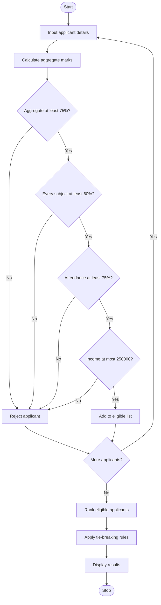

## 1. Problem Statement

Develop a Python program to allocate university scholarships based on students' academic performance, attendance, and family income.

The system should evaluate applicants using the following criteria:

- Aggregate marks: At least 75%.
- Subject-wise minimum marks: At least 60% in every subject.
- Attendance: At least 75%.
- Annual family income: Not more than ₹2,50,000.
- Ranking: Eligible students are ranked by aggregate marks in descending order.
- Tie-breaking rules: If aggregate marks are equal, prefer higher attendance. If attendance is also equal, prefer lower family income. If all three are equal, rank by applicant ID in alphabetical order.

The program should display eligible applicants, their ranks, and rejected applicants with the reasons for rejection.

## 2. Algorithm

1. Start the program.
2. Input the number of scholarship applicants.
3. For each applicant, enter the applicant ID, name, subject marks, attendance percentage, and annual family income.
4. Calculate the aggregate percentage from the subject marks.
5. Check the eligibility conditions:
   - Aggregate percentage is at least 75%.
   - Every subject mark is at least 60%.
   - Attendance is at least 75%.
   - Annual family income is at most ₹2,50,000.
6. If all conditions are satisfied, add the applicant to the eligible list. Otherwise, record the rejection reason.
7. Sort eligible applicants using the predefined ranking and tie-breaking rules.
8. Assign ranks to eligible applicants.
9. Display the eligible scholarship list and rejected applicants.
10. Stop the program.

## 3. Simple Flowchart 




## 5. Sample Input

The following example uses three subjects per applicant.

text

```
Enter number of applicants: 4
Enter number of subjects: 3

Applicant 1
Applicant ID: S103
Name: Anu
Subject 1 marks: 90
Subject 2 marks: 85
Subject 3 marks: 95
Attendance percentage: 90
Annual family income: 200000

Applicant 2
Applicant ID: S101
Name: Ravi
Subject 1 marks: 90
Subject 2 marks: 85
Subject 3 marks: 95
Attendance percentage: 95
Annual family income: 220000

Applicant 3
Applicant ID: S102
Name: Priya
Subject 1 marks: 80
Subject 2 marks: 75
Subject 3 marks: 85
Attendance percentage: 80
Annual family income: 180000

Applicant 4
Applicant ID: S104
Name: Arun
Subject 1 marks: 55
Subject 2 marks: 70
Subject 3 marks: 80
Attendance percentage: 90
Annual family income: 150000
```

## 6. Sample Output

text

```
===== ELIGIBLE SCHOLARSHIP APPLICANTS =====
Rank | ID | Name | Aggregate | Attendance | Income
1 | S101 | Ravi | 90.00% | 95.00% | Rs. 220000.00
2 | S103 | Anu | 90.00% | 90.00% | Rs. 200000.00
3 | S102 | Priya | 80.00% | 80.00% | Rs. 180000.00

===== REJECTED APPLICANTS =====
S104 | Arun | Aggregate below 75%, Subject mark below 60%
```

 require an additional rule specifying the available scholarships or budget.
