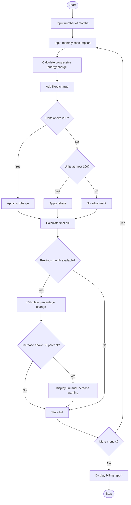

## 1. Problem Statement

Develop a Python program to calculate household electricity bills for multiple months using progressive consumption slabs, fixed charges, surcharges, and rebates. The program should compare monthly bills and identify unusual increases in electricity expenses.

The program uses these example billing rules:

- First 100 units: ₹2 per unit.
- Next 100 units: ₹3 per unit.
- Above 200 units: ₹5 per unit.
- Fixed monthly charge: ₹100.
- Surcharge: 5% of the energy charge when consumption exceeds 200 units.
- Rebate: 5% of the energy charge when consumption is 100 units or less.
- An increase of more than 30% compared with the previous month's bill is considered unusual.

## 2. Algorithm

1. Start the program.
2. Input the number of months.
3. For each month, input the electricity consumption in units.
4. Calculate the energy charge using progressive slabs.
5. Add the fixed monthly charge.
6. Apply the surcharge or rebate according to the consumption.
7. Calculate and store the final bill.
8. Compare the bill with the previous month's bill.
9. If the increase exceeds 30%, display an unusual-increase warning.
10. Display the monthly billing report.
11. Stop the program.

## 3. Simple Flowchart 




## 5. Sample Input

text

```
Enter number of months: 3

Month 1
Enter units consumed: 80

Month 2
Enter units consumed: 120

Month 3
Enter units consumed: 250
```

## 6. Sample Output

text

```
===== ELECTRICITY BILL REPORT =====

Month 1
Units consumed: 80.00
Energy charge: Rs. 160.00
Fixed charge: Rs. 100.00
Surcharge: Rs. 0.00
Rebate: Rs. 8.00
Final bill: Rs. 252.00

Month 2
Units consumed: 120.00
Energy charge: Rs. 260.00
Fixed charge: Rs. 100.00
Surcharge: Rs. 0.00
Rebate: Rs. 0.00
Final bill: Rs. 360.00
Monthly change: 42.86%
Warning: Unusual bill increase!

Month 3
Units consumed: 250.00
Energy charge: Rs. 750.00
Fixed charge: Rs. 100.00
Surcharge: Rs. 37.50
Rebate: Rs. 0.00
Final bill: Rs. 887.50
Monthly change: 146.53%
Warning: Unusual bill increase!
```

 them with the applicable electricity provider's rules when using the program for actual billing.
