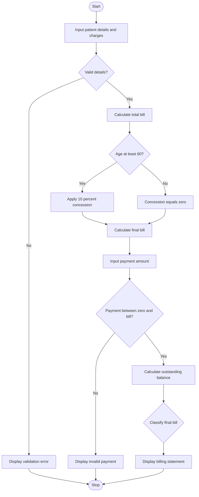

 ## Hospital Billing and Patient Classification System


## 1. Problem Statement

Hospital Billing and Patient Classification: Process consultation, diagnostic, and treatment charges, apply conditional concessions, validate billing constraints, and classify patients according to a supplied payment policy

## 2. Algorithm

1. Start the program.
2. Input patient ID, name, age, treatment charge, and payment amount.
3. Validate the patient details and charges.
4. Calculate the total bill by adding consultation, diagnostic, and treatment charges.
5. If the patient is aged 60 or above, apply a 10% concession.
6. Calculate the final bill after the concession.
7. Validate the payment amount against the final bill.
8. Calculate the outstanding balance.
9. Classify the patient according to the final bill amount.
10. Display the billing statement and patient classification.
11. Stop the program.

## 3.  Flowchart 




## 5. Sample Input


```
Enter patient ID: P101
Enter patient name: Ravi
Enter patient age: 65
Enter treatment charge: 4000
Enter payment amount: 3000
```

## 6. Sample Output


```
Total bill: Rs. 5500.0
Concession: Rs. 550.0
Final bill: Rs. 4950.0

===== HOSPITAL BILL =====
Patient ID: P101
Patient name: Ravi
Age: 65
Final bill: Rs. 4950.0
Amount paid: Rs. 3000.0
Outstanding balance: Rs. 1950.0
Patient classification: Medium
Payment status: Partially Paid
```


Note: The charges, concession rate, and classification thresholds are illustrative. They can be modified to match the hospital's actual billing and payment policy.
