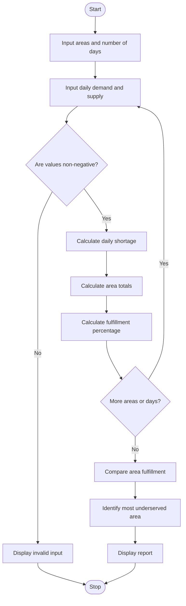

## Water Distribution Fairness Analysis System


## 1. Problem Statement
 Water Distribution Fairness Analysis: Analyse area-wise water supply across several days, calculate shortages against demand, compare distribution levels, and identify the most underserved areas

## 2. Algorithm

1. Start the program.
2. Input the number of areas and the number of days.
3. Enter the area name, daily water demand, and actual supply.
4. Validate that demand and supply values are non-negative.
5. Calculate daily shortages using `shortage = demand - supply` when demand exceeds supply; otherwise, shortage is zero.
6. Calculate total demand, total supply, and total shortage for each area.
7. Calculate the demand fulfillment percentage for each area.
8. Compare fulfillment percentages across areas.
9. Identify the area with the lowest fulfillment percentage.
10. Display the area-wise water distribution report.
11. Stop the program.

## 3. Flowchart 




## 5. Sample Input

Assume all water quantities are measured in litres for simplicity.


```
Enter number of areas: 3
Enter number of days: 2

Enter name of area 1: North
Day 1 for North
Enter water demand: 1000
Enter actual supply: 800
Day 2 for North
Enter water demand: 1000
Enter actual supply: 700

Enter name of area 2: South
Day 1 for South
Enter water demand: 1000
Enter actual supply: 900
Day 2 for South
Enter water demand: 1000
Enter actual supply: 950

Enter name of area 3: East
Day 1 for East
Enter water demand: 1000
Enter actual supply: 600
Day 2 for East
Enter water demand: 1000
Enter actual supply: 500
```

## 6. Sample Output


```
===== WATER DISTRIBUTION REPORT =====

Area: East
Total demand: 2000.00
Total supply: 1100.00
Total shortage: 900.00
Demand fulfilled: 55.00%

Area: North
Total demand: 2000.00
Total supply: 1500.00
Total shortage: 500.00
Demand fulfilled: 75.00%

Area: South
Total demand: 2000.00
Total supply: 1850.00
Total shortage: 150.00
Demand fulfilled: 92.50%

Most underserved area: East
Fulfillment percentage: 55.00%
```

