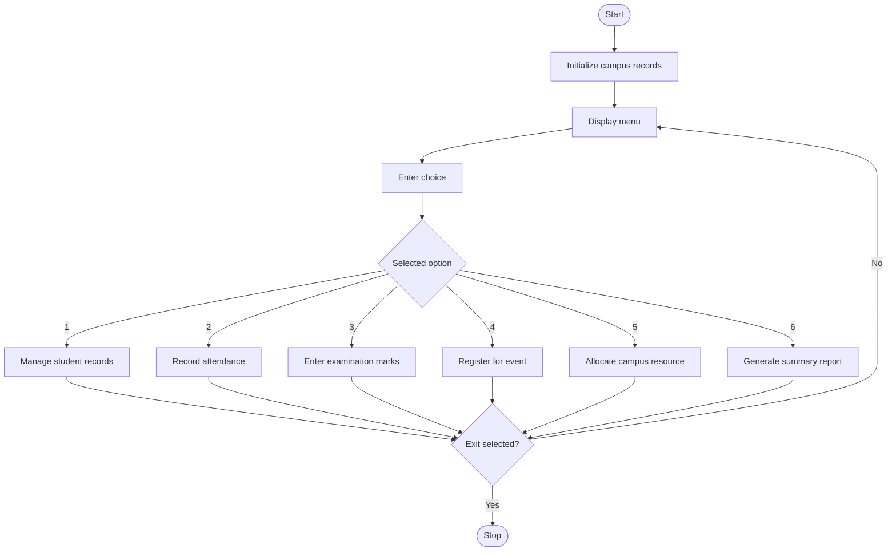

## 1. Problem Statement

Develop a menu-driven Python program to simulate a smart campus management system. The system should integrate student records, attendance tracking, examination marks, event registration, resource allocation, and summary reporting.

The program should use fundamental Python concepts, including variables, data types, operators, conditional statements, loops, strings, lists, nested lists, tuples, and tuple unpacking.

The system should provide the following features:

- Student records: Add and display student IDs, names, and departments.
- Attendance management: Record attendance and calculate attendance percentages.
- Marks management: Store examination marks and calculate student averages.
- Event registration: Register students for campus events.
- Resource allocation: Allocate available campus resources to students.
- Summary reporting: Display student details, attendance, marks, event registrations, and resource allocations.

## 2. Algorithm

1. Start the program.
2. Initialize lists for student records, attendance, marks, events, and resources.
3. Display the main menu.
4. Accept the user's choice.
5. Perform the selected operation:
   - Add or display student records.
   - Record attendance and calculate attendance percentage.
   - Enter examination marks and calculate averages.
   - Register a student for an event.
   - Allocate an available resource to a student.
   - Generate a summary report.
6. Validate IDs, marks, attendance, event names, and resource availability.
7. Return to the main menu after each operation.
8. Repeat until the user selects Exit.
9. Stop the program.

## 3.  Flowchart



## 5. Sample Input

text

```
Enter your choice: 1
Enter student ID: S101
Enter student name: Ravi
Enter department: CSE

Enter your choice: 2
Enter student ID: S101
Classes attended: 45
Total classes: 50

Enter your choice: 3
Enter student ID: S101
Enter mark 1: 85
Enter mark 2: 90
Enter mark 3: 80

Enter your choice: 4
Enter student ID: S101
Enter event name: Tech Fest

Enter your choice: 5
Enter student ID: S101
Enter resource name: Computer Lab

Enter your choice: 6

Enter your choice: 7
```

## 6. Sample Output

text

```
Student added successfully

Attendance: 90.0 %

Average marks: 85.0

Event registration successful

Available resources:
Computer Lab - Available: 2
Library Book - Available: 5
Sports Kit - Available: 3

Resource allocated successfully

===== CAMPUS SUMMARY REPORT =====

Student Records:
S101 Ravi CSE

Attendance:
S101 90.0 %

Examination Marks:
S101 [85.0, 90.0, 80.0] Average: 85.0

Event Registrations:
S101 Tech Fest

Resource Allocations:
S101 Computer Lab

Available Resources:
Computer Lab 1 available
Library Book 5 available
Sports Kit 3 available

Exiting Smart Campus Management System
```

