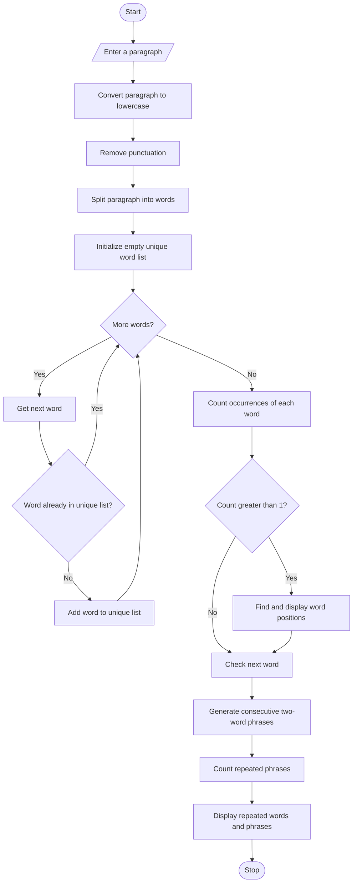

# Repeated Word and Phrase Detection Using Python

## 1. Problem Statement
Repeated Word and Phrase Detection: Process a paragraph, normalize letter case, count word occurrences using permitted string and list operations, and identify repeated words and their positions


## 2. Algorithm

1. Start the program.
2. Read a paragraph from the user.
3. Convert the entire paragraph into lowercase using `lower()`.
4. Remove punctuation using string operations.
5. Split the paragraph into individual words using `split()`.
6. Create an empty list to store unique words.
7. Traverse each word in the word list.
8. Count each word's occurrences using the `count()` function.
9. If the count is greater than one, identify it as a repeated word.
10. Find and display the positions of repeated words using list operations.
11. Generate consecutive two-word phrases.
12. Count phrase occurrences and identify repeated phrases.
13. Display the repeated words, their counts, positions, and repeated phrases.
14. Stop the program.

## 3. Flowchart 




## 4. Source Code (Python)

python

```

# Repeated Word and Phrase Detection

# Step 1: Get paragraph from user
paragraph = input("Enter a paragraph: ")

# Step 2: Convert to lowercase
paragraph = paragraph.lower()

# Step 3: Remove punctuation
for symbol in ".,!?;:\"'()[]{}":
    paragraph = paragraph.replace(symbol, "")

# Step 4: Split paragraph into words
words = paragraph.split()

# Step 5: Find unique words
unique_words = []

for word in words:
    if word not in unique_words:
        unique_words.append(word)

# Step 6: Detect repeated words
print("\n--- REPEATED WORDS ---")

found = False

for word in unique_words:
    count = words.count(word)

    if count > 1:
        found = True

        # Find positions (1-based indexing)
        positions = []

        for i in range(len(words)):
            if words[i] == word:
                positions.append(i + 1)

        print("Word:", word)
        print("Occurrences:", count)
        print("Positions:", positions)

if not found:
    print("No repeated words found.")

# Step 7: Generate consecutive two-word phrases
phrases = []

for i in range(len(words) - 1):
    phrase = words[i] + " " + words[i + 1]
    phrases.append(phrase)

# Step 8: Find unique phrases
unique_phrases = []

for phrase in phrases:
    if phrase not in unique_phrases:
        unique_phrases.append(phrase)

# Step 9: Detect repeated phrases
print("\n--- REPEATED PHRASES ---")

phrase_found = False

for phrase in unique_phrases:
    count = phrases.count(phrase)

    if count > 1:
        phrase_found = True

        positions = []

        for i in range(len(phrases)):
            if phrases[i] == phrase:
                positions.append(i + 1)

        print("Phrase:", phrase)
        print("Occurrences:", count)
        print("Positions:", positions)

if not phrase_found:
    print("No repeated phrases found.")
```

## 5. Sample Input

text

```
Enter a paragraph:

Python is easy to learn. Python is powerful.
Learning Python is easy and learning Python is fun.
```

## 6. Sample Output

text

```
--- REPEATED WORDS ---

Word: python
Occurrences: 4
Positions: [1, 5, 9, 13]

Word: is
Occurrences: 4
Positions: [2, 6, 10, 14]

Word: easy
Occurrences: 2
Positions: [3, 11]

Word: to
Occurrences: 1

Word: learn
Occurrences: 1

Word: powerful
Occurrences: 1

Word: learning
Occurrences: 2
Positions: [8, 12]

--- REPEATED PHRASES ---

No repeated phrases found.
```


