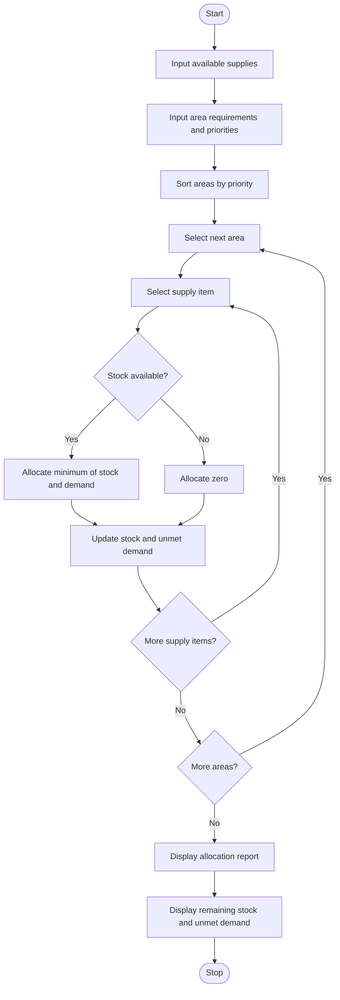

## 1. Problem Statement

Develop a Python program to allocate limited disaster relief supplies to different affected areas based on their requirements and urgency.

The program should:

- Accept the available stock of each relief item, such as food packets, water bottles, and medical kits.
- Accept the requirements of each affected area.
- Assign a priority level to each area: High, Medium, or Low.
- Allocate supplies to high-priority areas first, followed by medium- and low-priority areas.
- Ensure that allocations never exceed the available stock.
- Calculate the remaining stock and unmet demand for each area.
- Display a final relief allocation report.

Allocation policy: Process areas in descending priority order: High, Medium, then Low. If two areas have the same priority, process them in the order entered. For each area, allocate each supply item up to its remaining requirement and the available stock.

## 2. Algorithm

1. Start the program.
2. Input the number of supply types, affected areas, and available stock for each supply.
3. Input each area's name, priority, and required quantity of every supply type.
4. Assign priority values: High = 1, Medium = 2, Low = 3.
5. Sort the areas by priority.
6. For each area:
   - Compare its requirements with the remaining stock.
   - Allocate the smaller of the required quantity and available stock.
   - Update the available stock.
   - Calculate the unmet demand.
7. Display the allocation for every area.
8. Display remaining stock and total unmet demand for each supply type.
9. Stop the program.

## 3.  Flowchart




## 5. Sample Input

text

```
Enter supply names separated by spaces: Food Water

Available stock of Food: 100
Available stock of Water: 80

Enter number of affected areas: 3

Area 1
Area name: North
Priority (High/Medium/Low): High
Food required: 60
Water required: 50

Area 2
Area name: South
Priority (High/Medium/Low): Medium
Food required: 50
Water required: 40

Area 3
Area name: East
Priority (High/Medium/Low): Low
Food required: 30
Water required: 20
```

## 6. Sample Output

text

```
===== RELIEF ALLOCATION REPORT =====

Area: North | Priority: High
Food: Required=60, Allocated=60, Unmet=0
Water: Required=50, Allocated=50, Unmet=0

Area: South | Priority: Medium
Food: Required=50, Allocated=40, Unmet=10
Water: Required=40, Allocated=30, Unmet=10

Area: East | Priority: Low
Food: Required=30, Allocated=0, Unmet=30
Water: Required=20, Allocated=0, Unmet=20

===== REMAINING STOCK =====
Food : 0
Water : 0

===== TOTAL UNMET DEMAND =====
Food : 40
Water : 30
```

