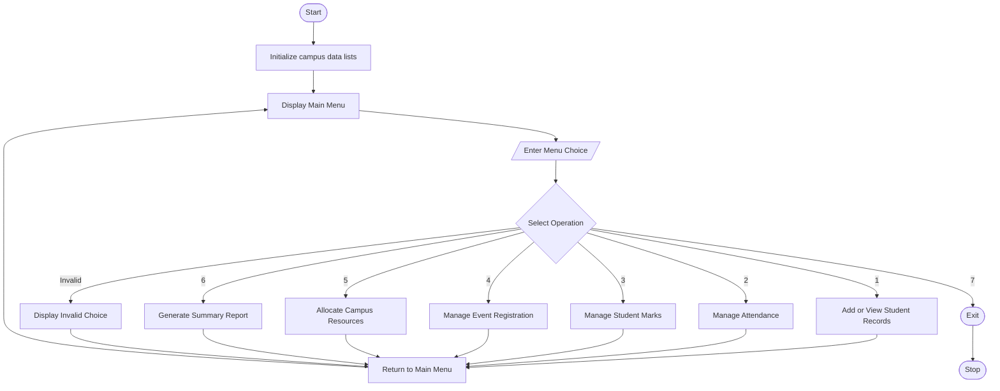

## Comprehensive Smart Campus Management Simulation Using Python
## 1. problem statement 
Comprehensive Smart Campus Management Simulation: Develop a menu-driven program that integrates student records, attendance, marks, event registration, resource allocation, and summary reporting using conditional statements, loops, strings, lists, nested lists, tuples, and tuple unpacking

## 2. Algorithm

1. Start the program.
2. Initialize empty lists for student records, attendance, marks, event registrations, and resource allocations.
3. Display the main menu.
4. Ask the user to select an operation.
5. Perform the selected operation using conditional statements.

Student Records:

- Accept student ID, name, and department.
- Store student information in a list.
- Display or search student records.

Attendance Management:

- Accept student ID and attendance status.
- Store attendance records.
- Calculate attendance percentage.

Marks Management:

- Accept student ID and subject-wise marks.
- Calculate total marks and average.
- Assign grades based on average marks.

Event Registration:

- Display available campus events.
- Accept student ID and event name.
- Register the student for the selected event.

Resource Allocation:

- Display available campus resources.
- Accept student ID and resource name.
- Allocate the resource if it is available.

Summary Reporting:

- Display student details.
- Display attendance percentage.
- Display academic performance.
- Display event registrations.
- Display allocated resources.

6. Repeat the menu until the user selects Exit.
7. Display an exit message.
8. Stop the program.

## 3. Flowchart





## 5. Sample Input

The following is an example of how to interact with the program.

Step 1: Add a student


```
Enter your choice: 1

--- STUDENT MANAGEMENT ---
1. Add Student
2. View Students
3. Search Student

Enter choice: 1
Enter Student ID: 101
Enter Student Name: Arun
Enter Department: CSE

Student added successfully!
```

Step 2: Record attendance

text

```
Enter your choice: 2

--- ATTENDANCE MANAGEMENT ---

Enter Student ID: 101
Enter Present Days: 45
Enter Total Working Days: 50

Attendance Recorded!
Attendance Percentage: 90.0 %
```

Step 3: Enter marks

text

```
Enter your choice: 3

--- MARKS MANAGEMENT ---

Enter Student ID: 101
Enter Number of Subjects: 3
Enter marks for Subject 1: 90
Enter marks for Subject 2: 85
Enter marks for Subject 3: 95

Total Marks: 270.0
Average: 90.0
Grade: A+
```

Step 4: Register for an event

text

```
Enter your choice: 4

--- EVENT REGISTRATION ---

Enter Student ID: 101

Available Events:
1. Technical Fest
2. Sports Day
3. Cultural Fest
4. Science Exhibition

Enter Event Name: Technical Fest

Event Registration Successful!
```

Step 5: Allocate a resource

text

```
Enter your choice: 5

--- RESOURCE ALLOCATION ---

Enter Student ID: 101

Available Resources:
1. Computer Lab
2. Seminar Hall
3. Sports Ground
4. Library

Enter Resource Name: Computer Lab

Resource Allocated Successfully!
```

## 6. Sample Output

Step 6: Generate summary report


```
Enter your choice: 6

========== SMART CAMPUS SUMMARY ==========

Student ID: 101
Name: Arun
Department: CSE

Attendance: 90.0 %

Subject Marks: [90.0, 85.0, 95.0]
Average Marks: 90.0

Registered Events: ['Technical Fest']

Allocated Resources: ['Computer Lab']

========== CAMPUS STATISTICS ==========

Total Students: 1
Attendance Records: 1
Marks Records: 1
Event Registrations: 1
Resource Allocations: 1
```


